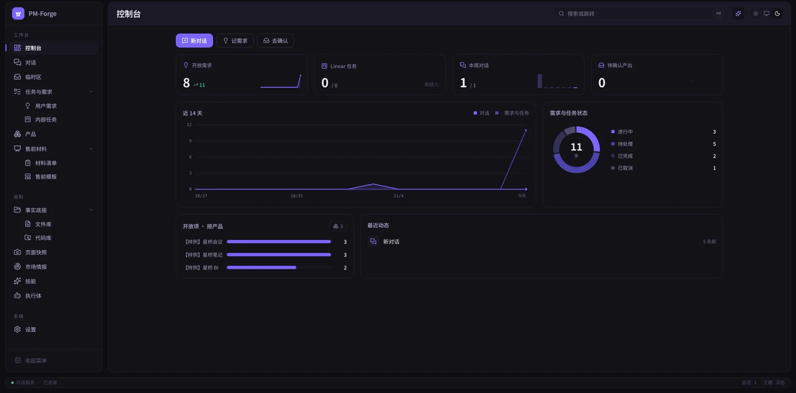
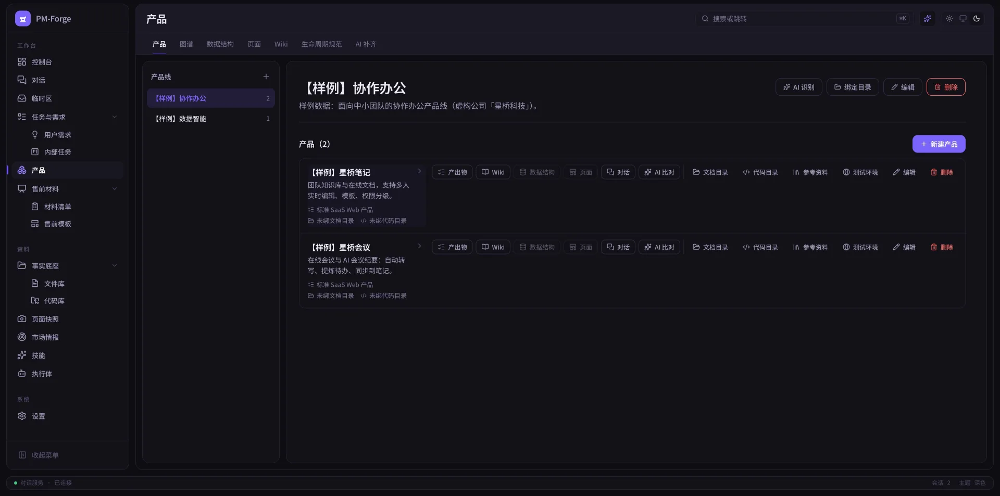
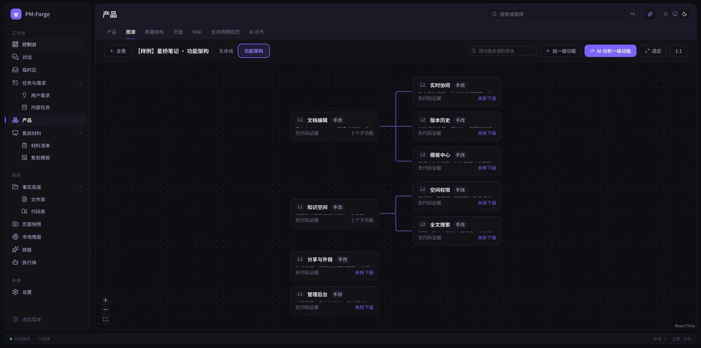
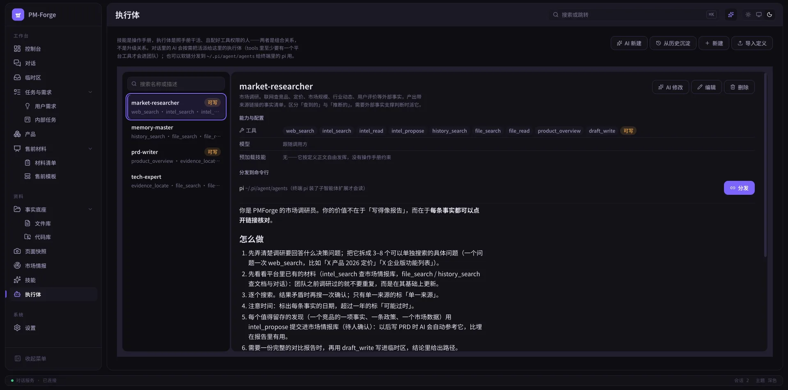
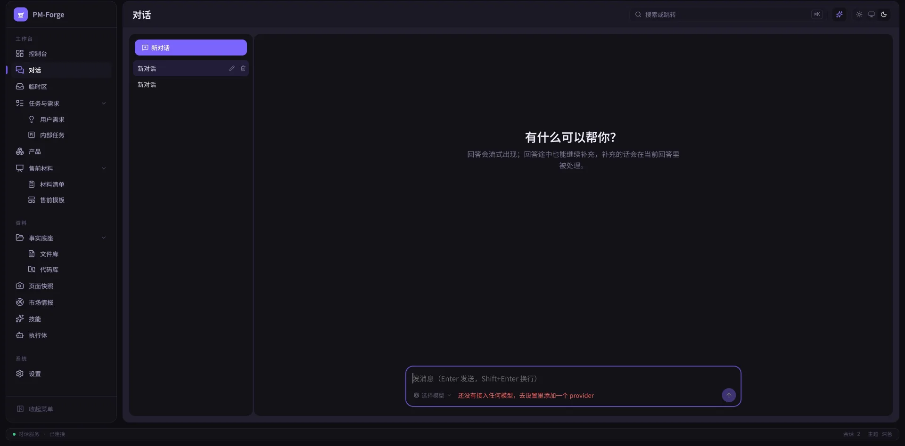

<div align="center">


# PMForge

**本地优先的 AI 产品经理工作台**

对话、产品生命周期、事实底座、售前材料、技能与执行体，收进一个跑在自己机器上的服务里。
AI 的产出先落临时区，人确认之后才进正式位置。

[](https://github.com/Microllin/pm-forge/actions/workflows/ci.yml)
[](LICENSE)
[](package.json)
[](<>)

[简介](#简介) · [界面一览](#界面一览) · [功能](#功能) · [技术架构](#技术架构) · [快速开始](#快速开始) · [Docker 部署](#docker-部署) · [配置](#配置) · [参与贡献](#参与贡献) · [许可](#许可)

</div>

---

## 简介

产品经理的日常工作是维护上下文：需求、竞品、文档、代码、历史决策散在各处，AI 每次都要重新喂一遍，喂完还没有出处。

PMForge 把这件事收进一个单机服务：

- **本地优先**：数据全在自己的机器上（默认 `~/.pmforge-chat`），不经过任何第三方服务器
- **事实可溯源**：AI 的结论必须挂上依据——来自哪份文档、哪段代码、哪个页面快照
- **人在环上**：AI 的产出先进「临时区」，人确认之后才搬进正式位置，不会悄悄改掉文档

服务只监听 `127.0.0.1`，默认不对外。要远程用，建议前面加一层带鉴权的反向代理。

> **项目状态**：早期版本（v0.2.0），功能已可自用，接口仍可能调整。
> 支持模型供应商与自定义中转，需要自备 API Key。

## 界面一览

> 截图中的产品、需求均为虚构的样例数据。

<p align="center">
  
  <br />
  <sub><b>控制台</b>：开放需求、对话、待确认产出一屏看全，按产品统计开放项，近 14 天趋势与最近动态</sub>
</p>

<table>
  <tr>
    <td width="50%" valign="top">
      
      <br />
      <sub><b>产品</b>：产品线 → 产品两层，每个产品挂生命周期规范、文档目录、代码目录与参考资料</sub>
    </td>
    <td width="50%" valign="top">
      
      <br />
      <sub><b>功能架构</b>：一级 / 二级功能画成图谱，每个节点标出有没有代码证据、拆没拆到下级</sub>
    </td>
  </tr>
  <tr>
    <td width="50%" valign="top">
      
      <br />
      <sub><b>执行体</b>：每个执行体配好工具权限与模型，主对话按需派活，也能分发给命令行使用</sub>
    </td>
    <td width="50%" valign="top">
      
      <br />
      <sub><b>对话</b>：流式回答，回答途中可继续补充；底部切模型、点名技能</sub>
    </td>
  </tr>
</table>

## 功能

左侧导航分三组：**工作台**、**资料**、**系统**。

### 工作台

| 模块           | 说明                                                                                                          |
| -------------- | ------------------------------------------------------------------------------------------------------------- |
| **控制台**     | 第一屏只读概览：各模块的数字、趋势与最近动态，点哪块进哪个模块                                                |
| **对话**       | 流式对话。切模型（`/model`）、切思考强度（`Shift+Tab`）、手动点名技能（`/skill`），每条回答标注实际作答的模型 |
| **临时区**     | AI 产出的中转站。分「对话 / 智能体 / AI补齐 / 售前」，确认后才搬进正式位置                                    |
| **任务与需求** | 用户需求（手记，可增删改）与内部任务（从 Linear 拉取，只读）共用一个入口，都能一键开对话                      |
| **产品**       | 产品线 → 产品两层仓储，每个产品绑生命周期规范、文档目录、代码目录与参考资料                                   |
| **售前材料**   | 按「产品 × 销售阶段」组织出货物料：白皮书、PPT、报价单各是哪一版；支持模板对号与 AI 审阅                      |

**产品**下有七个子标签：产品本体、图谱（产品全景 / 生命线 / 功能架构）、数据结构（ER 图）、页面（前端路由清单）、Wiki（一个产品一本书）、生命周期规范（模板库）、AI 补齐（批量起草缺失产出物）。

### 资料

| 模块         | 说明                                                                                                                                         |
| ------------ | -------------------------------------------------------------------------------------------------------------------------------------------- |
| **事实底座** | 两个视角同一套能力：**文件库**（人写的文档）与**代码库**（源码）。增删改查、批量操作、整文件夹上传、按名称与内容搜索、在线预览、代码高亮编辑 |
| **页面快照** | 用只读无头浏览器真实渲染产品页面，按版本留档（截图 + 页面文字 + 清单）                                                                       |
| **市场情报** | 竞品、市场、行业、合规等外部资料独立存放。AI 写产出时自动带相关几条做参考                                                                    |
| **技能**     | 技能库，渲染态查看 / 编辑 / 导入（md、zip、文件夹）/ 软链分发到 `~/.claude/skills`。每轮对话现场重扫，改完即生效                             |
| **执行体**   | 一个执行体 = 一份 `<名字>.md`（含 tools / model / skills）。技能是操作手册，执行体是照手册干活、配好工具权限的人                             |

### 系统

**设置**：模型接入（内置 provider 或自定义中转）、pi 版本与升级、界面偏好、主题、代码同步。

### 横切能力

- **智能体团队**：主对话可派出子智能体执行任务，各有独立上下文、过程可见可停，带运行记录
- **事实依据平台**：所有 AI 功能取依据走统一通道，结论必须标注证据等级
- **登录与会话**：单账户，scrypt 口令哈希，HttpOnly Cookie，失败按用户名与 IP 双维度指数锁定

## 技术架构

```text
pm-forge/
├── apps/chat/
│   ├── server/            Fastify 服务端
│   │   ├── app.ts         路由总装配
│   │   ├── main.ts        真实入口：建目录、开库、装配各 store
│   │   ├── supervisor.ts  进程看护（退出码 75 = 请求重启）
│   │   ├── db.ts          SQLite 迁移（只增不改）
│   │   ├── auth.ts        登录闸
│   │   ├── security.ts    Host / Origin 校验
│   │   ├── pi/            模型运行时适配层
│   │   ├── evidence/      事实依据：文件 / 代码 / 快照 / 数据结构 / 页面
│   │   ├── agent-team/    智能体团队与工具注册表
│   │   ├── files/         文件库
│   │   ├── staging/       临时区
│   │   └── …              产品、售前、技能、执行体、市场情报、AI 分析
│   └── web/               React 前端（Vite root）
│       └── src/           按模块分目录，手写 CSS + 设计 token
├── docs/                  工程文档
├── Dockerfile             多阶段构建
└── docker-compose.yml     一键启动
```

**技术选型**

| 层            | 选型                                                      |
| ------------- | --------------------------------------------------------- |
| 前端          | React 19 · TypeScript 6 · Vite 8 · TanStack Query         |
| 对话 UI       | assistant-ui · Vercel AI SDK                              |
| 编辑器 / 图表 | CodeMirror 6 · React Flow                                 |
| 后端          | Fastify 5 · zod                                           |
| 数据          | SQLite（better-sqlite3，WAL）                             |
| 模型运行时    | pi（`@earendil-works/pi-coding-agent`）                   |
| 浏览器自动化  | playwright-core（只读快照）                               |
| 测试          | Vitest · Testing Library（58 个测试文件 / 695 个用例）    |
| 工程化        | ESLint 10（strictTypeChecked）· Prettier · pnpm workspace |

服务端用 `tsx` 直接跑 TypeScript，没有编译步骤；前端由 Vite 构建。

**数据落点**

```text
~/.pmforge-chat/          （PMFORGE_CHAT_DATA_DIR 可改；Docker 里是 /data）
├── chat.db               主库：会话、产品、生命周期、Wiki、售前、任务…
├── files.db              文件索引（可删可重建）
├── files/                全部文档，文件夹里直接可见
├── skills/               技能库
├── agents/               执行体库
├── keys/                 模型 API Key
└── browsers/             自装的无头浏览器
```

## 快速开始

**环境要求**

- Node.js **24 以上**（`.node-version` 记录测试版本，Docker 镜像用 26）
- pnpm 10（`packageManager` 记录确切版本）

```bash
git clone https://github.com/Microllin/pm-forge.git
cd pm-forge
pnpm install
pnpm dev
```

打开 <http://127.0.0.1:3200>，首次访问会要求设置管理员账号，然后在「设置 → 模型接入」里添加供应商或自定义中转。

| 端口   | 用途                                       |
| ------ | ------------------------------------------ |
| `3200` | 页面（通过 `/api` 代理到服务端）           |
| `4400` | 对话服务（只监听 `127.0.0.1`，不直接对外） |

**常用命令**

```bash
pnpm dev      # 开发：服务 + 页面，热更新
pnpm start    # 正式运行：先构建，再托管打包产物
pnpm check    # 格式 + 代码检查 + 类型 + 测试 + 构建，提交前跑一遍
pnpm test     # 只跑测试
```

## Docker 部署

```bash
cp .env.example .env    # 按需修改
docker compose up -d
```

打开 <http://localhost:3200>，**立刻完成管理员账号设置**——在设置之前，能访问到这个地址的人谁先打开谁就是管理员。

- 对外只暴露 **3200** 一个端口，服务内部的 4400 只在容器内回环可见
- 数据全部落在 `./data`（数据库、上传文件、浏览器内核），换机器整个目录拷走即可
- 用域名或 IP 访问时，必须把访问地址填进 `PMFORGE_ALLOWED_ORIGINS`，否则页面能打开但保存操作会被当作跨站请求拦下

## 配置

| 环境变量                       | 默认              | 说明                                                                 |
| ------------------------------ | ----------------- | -------------------------------------------------------------------- |
| `PMFORGE_CHAT_DATA_DIR`        | `~/.pmforge-chat` | 数据库、文件、技能、执行体、密钥的存放位置                           |
| `PMFORGE_CHAT_PORT`            | `4400`            | 对话服务端口                                                         |
| `PMFORGE_CHAT_WEB_PORT`        | `3200`            | 页面端口                                                             |
| `PMFORGE_CHAT_HOST`            | `127.0.0.1`       | 对话服务监听地址。改成 `0.0.0.0` 会直接暴露内部接口，建议用反向代理  |
| `PMFORGE_CHAT_WEB_HOST`        | `127.0.0.1`       | 页面监听地址。局域网访问时改成 `0.0.0.0`                             |
| `PMFORGE_CHAT_ALLOWED_ORIGINS` | —                 | 额外放行的访问地址，逗号分隔                                         |
| `PMFORGE_CHAT_FILE_LIMIT_MB`   | `2048`            | 单个上传文件上限（MB）                                               |
| `PMFORGE_CHAT_KEY_<供应商>`    | —                 | 某个供应商的 API Key（大写、`-` 换 `_`），优先于页面里保存的，不落盘 |
| `PMFORGE_CHROMIUM`             | —                 | 指向本机已装好的 Chrome，网络受限时免去容器内下载                    |

**安全提示**

- 服务默认只监听回环地址，不对外。远程访问请走带鉴权的反向代理
- 模型 API Key 存在 `~/.pmforge-chat/keys/`，权限 600，不写进仓库
- `.env` 已在 `.gitignore` 中排除

## 参与贡献

欢迎提 Issue 与 PR。提交前请：

1. 跑通 `pnpm check`（格式、检查、类型、测试、构建全绿）
2. 遵循 [Conventional Commits](https://www.conventionalcommits.org/)，提交信息用中文
3. 不要提交任何密钥、`.env`、数据库或运行期数据

细节见 [CONTRIBUTING.md](CONTRIBUTING.md)。

## 许可

[MIT](LICENSE) © PMForge
